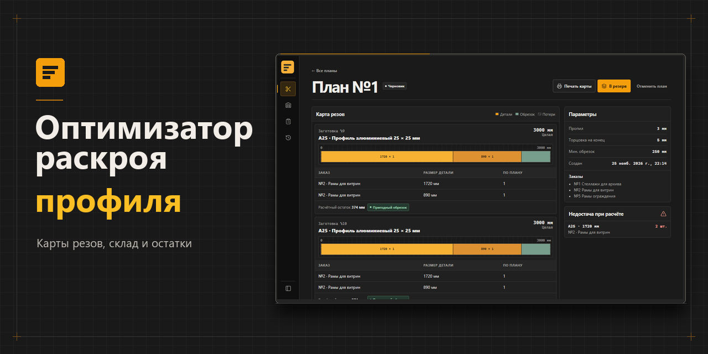
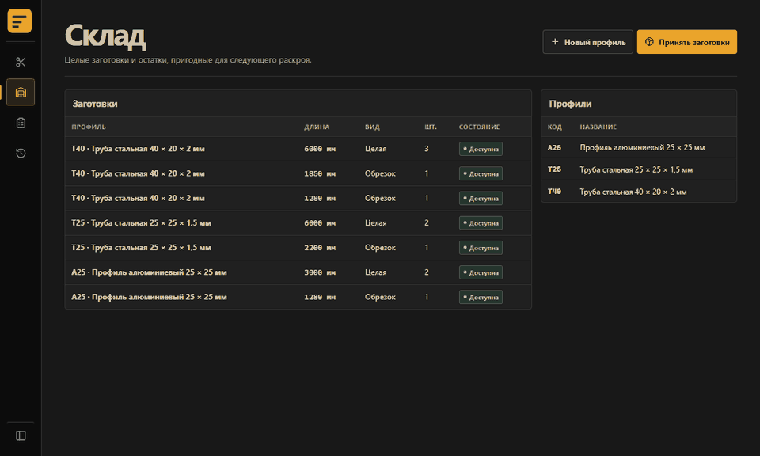
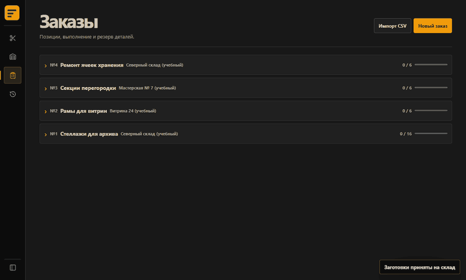
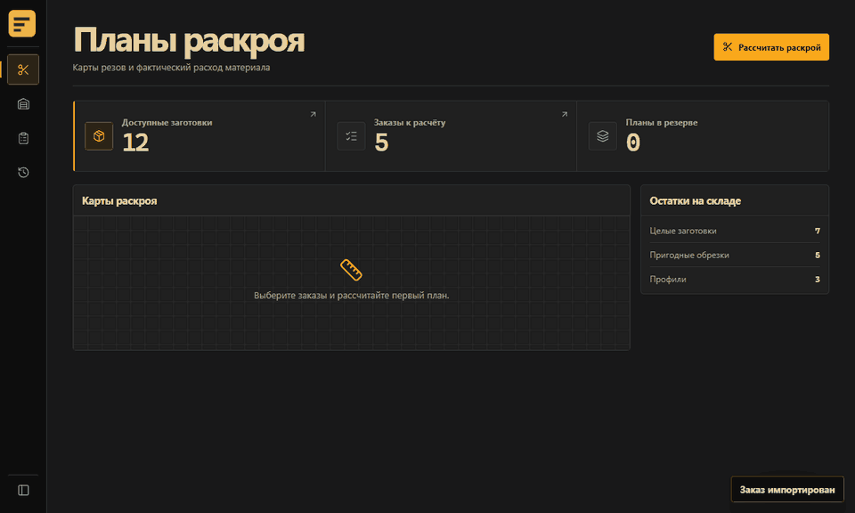
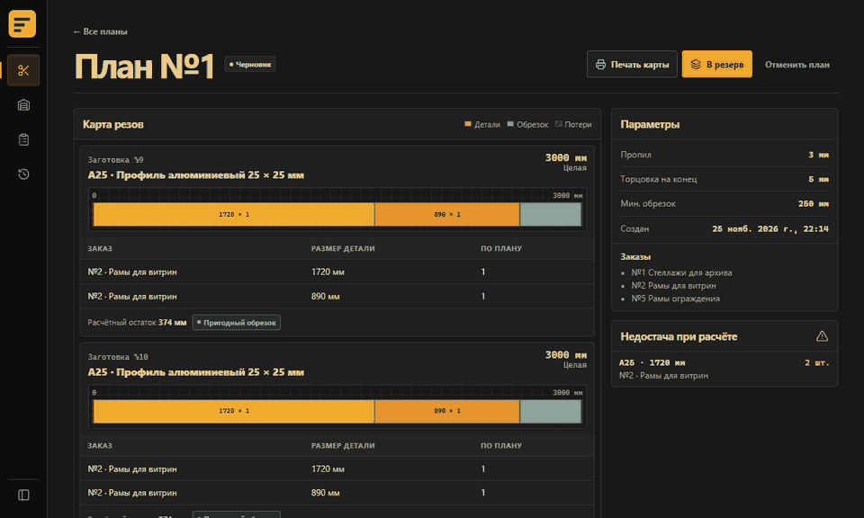

# Оптимизатор раскроя профиля



Когда в работу идут несколько заказов, приходится вручную подбирать заготовки, считать пропил и искать пригодные обрезки. Приложение собирает этот расчёт в одну карту. Оно показывает, что можно вырезать из имеющегося материала, чего не хватает и какие остатки вернутся на склад.

## Быстрый старт

Нужны Windows, JDK 21 и Maven 3.9. Скрипт ищет JDK и Maven в `%LOCALAPPDATA%/HodToolchain`, затем в `PATH`.

```powershell
.\run.ps1 -Demo -Port 8097 -Background
```

Откройте [127.0.0.1:8097](http://127.0.0.1:8097). В учебной базе уже есть три профиля, одиннадцать заготовок, в том числе четыре обрезка, и четыре вымышленных заказа. Один заказ на алюминиевые рамы специально требует больше материала, чем есть на складе. Повторный запуск сохраняет изменения в демо.

Для работы со своим складом запустите приложение без параметра `-Demo`.

```powershell
.\run.ps1 -Rebuild -Background
```

Откройте [127.0.0.1:8091](http://127.0.0.1:8091). Рабочие данные хранятся в `data/workshop.mv.db`, учебные в `data/workshop-demo.mv.db`. На пустом складе кнопка «Демо-данные» заполнит текущую базу примерами. Для одиночной проверки удобнее отдельный запуск с `-Demo`.

Собранный файл находится в `target/optimizator.jar`. Скрипт собирает его при первом запуске или с `-Rebuild`. Для запуска в терминале уберите `-Background`. Остановка по Ctrl+C. При фоновом запуске журнал и PID находятся в `.run`. Перед резервным копированием файлов H2 остановите приложение.

## Как работать

### 1. Примите заготовки на склад

Создайте профиль в разделе «Склад». В «Принять заготовки» выберите профиль, вид материала, длину и количество. Пригодный для работы обрезок учитывается как отдельная заготовка.



### 2. Добавьте заказ

Откройте «Заказы». Введите позиции вручную или загрузите CSV из Excel. В каждой строке укажите код профиля, длину детали в миллиметрах и количество. Для проверки подойдёт [учебный CSV](docs/demo-order.csv).



### 3. Рассчитайте раскрой

Откройте «Планы раскроя» и выберите заказы. Укажите ширину пропила, торцовку на один конец и минимальную длину пригодного обрезка. В карте видно, какие детали вырезать из каждой заготовки и по каким позициям материала не хватило. Кнопка «Печать карты» открывает светлую версию для печати на A4.



### 4. Зарезервируйте материал и внесите факт

Переведите готовый план в резерв. Заготовки и детали будут закреплены за ним. После работы введите количество готовых деталей и измеренный остаток. Если поле остатка пустое, приложение использует расчётную длину. Пригодные обрезки вернутся на склад. В журнале появится запись о выполнении.



## Расчёт и ограничения

- Длины задаются в миллиметрах с точностью до 0,1 мм. Расчёт идёт целыми десятыми долями миллиметра.
- С каждой задействованной заготовки снимается торцовка с двух концов. На каждую деталь учитывается один пропил. Профили планируются отдельно по кодам.
- Алгоритм сравнивает два варианта раскроя по недостаче, числу заготовок и отходам. Глобальный оптимум не гарантируется.
- Резерв снимается при отмене. При конфликте со складом или заказом нужен новый расчёт. Точный повтор подтверждения возвращает сохранённый результат без двойного списания.
- В одном расчёте допускается до 30 заказов и 2 000 деталей. В заказе или CSV до 200 строк, на складе до 10 000 активных заготовок. Максимальный размер CSV составляет 128 КБ.
- Импорт принимает CSV в UTF-8, Windows-1251 и UTF-16 с BOM. Прямой импорт XLSX отсутствует.
- Приложение хранит данные в локальном H2 и слушает `127.0.0.1`. Рабочий сценарий рассчитан на один компьютер.

## Проверка

```powershell
mvn test
```

Тесты проверяют учёт пропила и торцовки, разделение профилей, расчёт недостачи, защиту от двойного резерва, фактическое производство, возврат обрезка, импорт и повторный запуск демо. Все GIF записаны в браузере на вымышленных данных.

## Источники интерфейса

- Цветовые токены для тёмных поверхностей и янтарного акцента. [Graphite](https://21st.dev/community/themes/graphite), [Amber Minimal](https://21st.dev/community/themes/amber-minimal)
- Компактная сворачиваемая навигация. [Dashboard with Collapsible Sidebar](https://21st.dev/@uniquesonu/components/dashboard-with-collapsible-sidebar)
- Сводка склада и заказов. [Data Card](https://21st.dev/@lailai0916/components/data-card)
- Иконки из локального SVG-спрайта. [Lucide](https://lucide.dev/), [лицензия](src/main/resources/static/LICENSE-lucide.txt)

